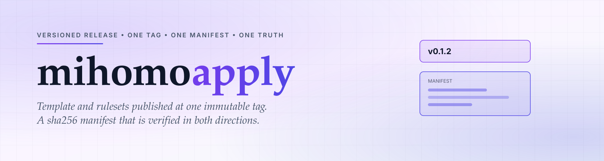

<div align="center">

<a href="https://github.com/CauriumX/mihomo-apply">
  <picture>
    <source media="(prefers-color-scheme: dark)" srcset="assets/hero-dark.svg">
    
  </picture>
</a>

</div>

<div align="center">

[][ci]
[][tags]
[][osi]

</div>

<h1 align="center">mihomo-apply</h1>

<div align="center">

> Versioned release: template and rulesets at one tag.

</div>

> [!NOTE]
> This repository has a publishing side effect. It is the only stage in the
> pipeline that changes what a client will run on its next restart.

<div align="center">

English | [简体中文](README.zh-CN.md)

</div>

---

## Why

Two artifacts that must agree — a template and the rulesets it references — will
drift apart the moment one of them is pinned by a different mechanism. The
failure is quiet: the config still parses, the client still starts, only the
routing table is wrong.

The fix is to publish both at one immutable tag, so there is no pair of versions
that can disagree.

## What

The release repository, and the only data source for subscribers:

- **24 rulesets** — 19 domain, 3 IP, Crypto, PayPal
- **One rendered template**, every provider URL pointing at the current tag
- **A manifest** recording the sha256 of every artifact
- **A release script** that renders, verifies, and refuses to overwrite a tag

## Structure

```
release.sh                 render template, copy artifacts, write MANIFEST
site/*.mrs                 19 domain rulesets
geoip/*.mrs                3 IP rulesets
Crypto.mrs  PayPal.mrs
PayPal-Phish.txt           inlined into the template as REJECT
template.yaml              rendered, URLs pinned to this tag
MANIFEST.json              sha256 of every artifact
VERSION                    current tag
```

## Quick start

Subscribe with a pinned tag. Never a drifting ref.

```
https://cdn.jsdelivr.net/gh/CauriumX/mihomo-apply@v0.1.2/template.yaml
```

Reference one ruleset:

```yaml
rule-providers:
  AI-Site:
    type: http
    behavior: domain
    format: mrs
    url: "https://cdn.jsdelivr.net/gh/CauriumX/mihomo-apply@v0.1.2/site/AI-Site.mrs"
    path: ./ruleset/AI-Site.mrs
    proxy: DIRECT
    interval: 600
```

Release a new version from the Actions tab, or:

```sh
gh workflow run ci.yml --repo CauriumX/mihomo-apply -f version=v0.1.3
```

## Design rules

**Versions are tags, not directories.** A tag is immutable and jsDelivr caches
it permanently, so `@v0.1.2/site/X.mrs` cannot change under a client. A nested
`@v0.1.2/v0.1.2/` path adds nothing — the directory would duplicate what the tag
already says.

**A tag is never overwritten.** `release.sh` checks for an existing tag and
refuses, querying the GitHub API when a shallow clone cannot see it. Republishing
the same version would invalidate a cache that is otherwise permanent.

**The manifest is verified in both directions.** Every declared artifact must
match its sha256, and every file on disk must be declared. A hand-edited ruleset
with a stale manifest fails the build.

**The CDN is checked after publishing.** jsDelivr indexing is not instant. The
release job waits for `template.yaml` to resolve, then compares every artifact
against its manifest hash.

**Ruleset artefacts are not part of the manifest's exclusion list by accident.**
`.git`, `.github`, scripts, and docs are excluded because they are not published
content. Including them would make the manifest change on every commit and stop
being a fingerprint of what clients actually receive.

## Adopting

Rolling back means tagging the previous content again:

```sh
git checkout v0.1.1 -- .
git commit -m "rollback to v0.1.1"
git tag v0.1.3
git push origin main --tags
```

The old tag stays. Clients pinned to it are unaffected.

## Feedback

Issues and PRs are welcome. If a subscription fails to load, include the tag you
are pinned to and the error the client reported — the manifest makes it possible
to tell a bad artifact from a stale cache.

## License

MIT © CauriumX

[ci]: https://github.com/CauriumX/mihomo-apply/actions
[tags]: https://github.com/CauriumX/mihomo-apply/tags
[osi]: https://opensource.org/licenses/MIT