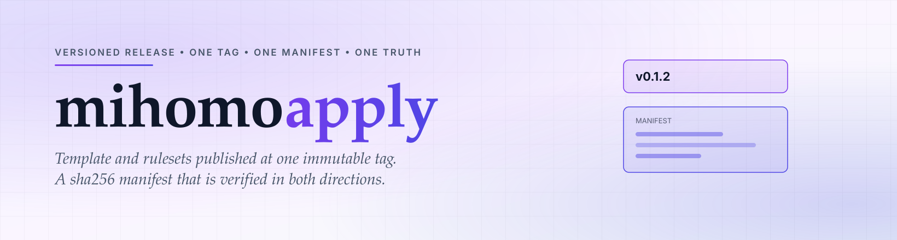

<div align="center">

<a href="https://github.com/CauriumX/mihomo-apply">
  <picture>
    <source media="(prefers-color-scheme: dark)" srcset="assets/hero-dark.svg">
    
  </picture>
</a>

</div>

<div align="center">

[][ci]
[][tags]
[][osi]

</div>

<h1 align="center">mihomo-apply</h1>

<div align="center">

> 版本化发布：模板与规则集在同一个 tag。

</div>

> [!NOTE]
> 本仓库有发布副作用。它是整条流水线里唯一会改变「客户端下次启动跑什么」的环节。

<div align="center">

[English](README.md) | 简体中文

</div>

---

## 为什么

两个必须一致的产物 —— 模板和它引用的规则集 —— 一旦用不同机制锁定版本，就会漂开。这种失效是安静的：配置照样解析，客户端照样启动，只是路由表错了。

解法是把两者发布在同一个不可变的 tag 上，这样就不存在一对能互相矛盾的版本。

## 是什么

发布仓，也是订阅者唯一的数据源：

- **24 个规则集** —— 19 个域名、3 个 IP、Crypto、PayPal
- **一份渲染后的模板**，每个 provider URL 都指向当前 tag
- **一份清单**，记录每个产物的 sha256
- **一个发布脚本**，负责渲染、校验，并拒绝覆盖已存在的 tag

## 目录

```
release.sh                 渲染模板、复制产物、写 MANIFEST
site/*.mrs                 19 个域名规则集
geoip/*.mrs                3 个 IP 规则集
Crypto.mrs  PayPal.mrs
PayPal-Phish.txt           内联进模板作为 REJECT
template.yaml              渲染后，URL 锁定到本 tag
MANIFEST.json              每个产物的 sha256
VERSION                    当前 tag
```

## 快速开始

用锁定的 tag 订阅，不要用漂移的 ref。

```
https://cdn.jsdelivr.net/gh/CauriumX/mihomo-apply@v0.1.2/template.yaml
```

引用单个规则集：

```yaml
rule-providers:
  AI-Site:
    type: http
    behavior: domain
    format: mrs
    url: "https://cdn.jsdelivr.net/gh/CauriumX/mihomo-apply@v0.1.2/site/AI-Site.mrs"
    path: ./ruleset/AI-Site.mrs
    proxy: DIRECT
    interval: 600
```

在 Actions 页面发新版本，或：

```sh
gh workflow run ci.yml --repo CauriumX/mihomo-apply -f version=v0.1.3
```

## 设计约束

**版本由 tag 表达，不套目录。** tag 不可变，jsDelivr 对它永久缓存，所以 `@v0.1.2/site/X.mrs` 不会在客户端脚下改变。嵌套的 `@v0.1.2/v0.1.2/` 路径没有增加任何信息 —— 目录只是重复了 tag 已经说过的话。

**tag 绝不覆盖。** `release.sh` 检查 tag 是否存在并拒绝，浅克隆看不到 tag 时改问 GitHub API。重发同一版本，会让一个本来永久的缓存失效。

**清单双向校验。** 每个声明的产物必须匹配它的 sha256，磁盘上每个文件也必须被声明。手工改过规则集但清单没更新，构建失败。

**发布后校验 CDN。** jsDelivr 索引不是即时的。发布任务会等 `template.yaml` 可解析，然后逐项比对产物的清单哈希。

**清单的排除列表不是随手写的。** `.git`、`.github`、脚本、文档被排除，因为它们不是发布内容。把她们算进去，清单会随每次提交变化，就不再是「客户端实际收到什么」的指纹。

## 采纳

回滚意味着把旧内容重新打一个 tag：

```sh
git checkout v0.1.1 -- .
git commit -m "rollback to v0.1.1"
git tag v0.1.3
git push origin main --tags
```

旧 tag 保留。锁定在旧 tag 上的客户端不受影响。

## 反馈

欢迎 issue 与 PR。如果订阅加载失败，请附上你锁定的 tag 和客户端报的错误 —— 有清单在手，可以区分是产物错了还是缓存旧了。

## License

MIT © CauriumX

[ci]: https://github.com/CauriumX/mihomo-apply/actions
[tags]: https://github.com/CauriumX/mihomo-apply/tags
[osi]: https://opensource.org/licenses/MIT